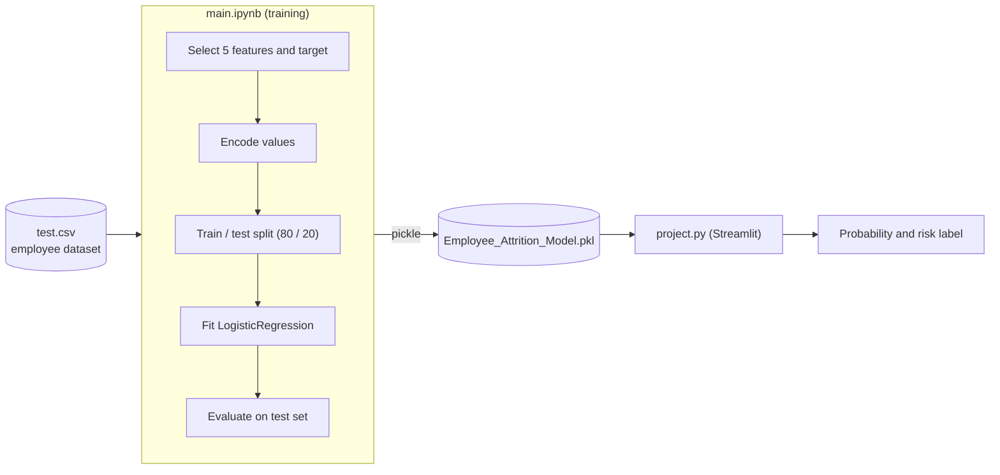
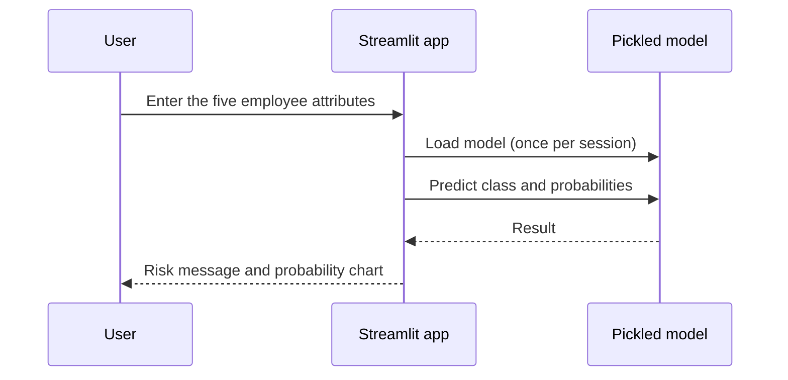

<div align="center">

# Employee Attrition Predictor

**A logistic-regression classifier and Streamlit app that estimates the likelihood that an employee will leave, from five employment attributes.**


[Overview](#overview) ·
[Quick start](#quick-start) ·
[How it works](#how-it-works) ·
[Evaluation](#evaluation) ·
[Limitations](#limitations) ·
[Responsible use](#responsible-use-and-privacy)

</div>

---

## Table of contents

- [Overview](#overview)
- [Features](#features)
- [How it works](#how-it-works)
- [Data](#data)
- [Model](#model)
- [Evaluation](#evaluation)
- [Quick start](#quick-start)
- [Using the app](#using-the-app)
- [Project structure](#project-structure)
- [Configuration and customization](#configuration-and-customization)
- [Model persistence](#model-persistence)
- [Troubleshooting](#troubleshooting)
- [Limitations](#limitations)
- [Responsible use and privacy](#responsible-use-and-privacy)
- [Roadmap](#roadmap)
- [Contributing](#contributing)
- [License](#license)
- [Author](#author)

---

## Overview

Employee turnover is costly: organizations lose experience and spend time and money on replacement hiring. This project trains a supervised binary classifier on tabular HR data to estimate the probability that an employee leaves, and serves the trained model through a small Streamlit web interface.

The repository contains two parts:

1. **Training** — a Jupyter notebook (`main.ipynb`) that prepares the data, trains a logistic-regression model, evaluates it, and saves it as a pickle file.
2. **Serving** — a Streamlit app (`project.py`) that loads the saved model and returns a prediction and probability for one employee at a time.

> **Scope:** this is an educational and portfolio project. It has not been validated for making real employment decisions. See [Limitations](#limitations) and [Responsible use and privacy](#responsible-use-and-privacy).

## Features

| Feature | Description |
|---------|-------------|
| Binary classification | Logistic regression predicting whether an employee leaves or stays |
| Five input features | Age, years at company, monthly income, job satisfaction, distance from home |
| Probability output | The app shows class probabilities, not just a label |
| Interactive web form | Streamlit interface; no code required to get a prediction |
| Model persistence | Trained model saved to `Employee_Attrition_Model.pkl` and loaded by the app |
| Reproducible training | All preparation and training steps live in one notebook |

<!-- TODO: add a screenshot of the Streamlit app, e.g. images/app.png -->

## How it works



### Inference flow



<!-- VERIFY: confirm whether the model is cached across reruns and whether any scaling or encoding is applied in project.py before prediction. -->

## Data

The model is trained from `test.csv`, which contains one row per employee with 24 columns in the raw file. Only the following columns are used.

| Column | Meaning | Type |
|--------|---------|------|
| `Age` | Employee age | Numeric |
| `YearsAtCompany` | Tenure in years | Numeric |
| `MonthlyIncome` | Monthly pay, in the dataset's currency units | Numeric |
| `JobSatisfaction` | Satisfaction level, encoded 0 to 3 (Low to Very High) | Ordinal |
| `DistanceFromHome` | Commute distance in kilometers | Numeric |
| `Attrition` | Target: whether the employee left or stayed | Binary |

The remaining raw columns are dropped. The notebook is the source of truth for exact column names and the encoding of the target.

<!-- VERIFY: (1) the exact target encoding. The previous README stated 0 = Left, 1 = Stayed, which is the reverse of the usual convention of 1 = event of interest; confirm this in main.ipynb and keep predict_proba column order consistent with it. (2) Dataset source, license, row count, and whether it is synthetic. -->

**Data provenance is not documented in the repository.** Add the dataset's source, license, size, class balance, and whether it is real or synthetic. Results on a synthetic dataset say little about real organizations.

## Model

| Item | Detail |
|------|--------|
| Algorithm | `sklearn.linear_model.LogisticRegression` |
| Task | Binary classification |
| Inputs | 5 features listed above |
| Split | 80 percent train, 20 percent test |
| Output | Predicted class and class probabilities (`predict_proba`) |
| Artifact | `Employee_Attrition_Model.pkl` |

Logistic regression was chosen because it suits a binary outcome, is fast to train, has interpretable coefficients, and produces probability estimates. It is a baseline; it cannot capture non-linear effects or interactions between features without additional engineering.

The previous README mentioned encoding and normalization steps. Whether scaling is applied, and whether the same transformation is applied inside `project.py` at prediction time, should be confirmed: a model trained on scaled inputs must receive identically scaled inputs when serving, or predictions will be wrong. Saving preprocessing and model together as a single scikit-learn `Pipeline` removes this risk (see [Roadmap](#roadmap)).

## Evaluation

`main.ipynb` evaluates the model on the held-out 20 percent test set. Report the following in the notebook and record the values here:

| Metric | Why it matters for attrition |
|--------|------------------------------|
| Class balance | Attrition datasets are often imbalanced; accuracy alone can look high for a model that rarely predicts "leaves" |
| Confusion matrix | Shows false positives and false negatives separately |
| Precision, recall, F1 (leaving class) | Measures how well at-risk employees are actually found |
| ROC-AUC | Threshold-independent ranking quality |

<!-- TODO: add the measured values from main.ipynb as a table. -->

**Note on earlier figures.** The previous README quoted "accuracy about 87 percent", "MAE 0.13", and "R² 0.73". Those figures could not be verified from the repository and are not repeated here. MAE and R² are regression metrics and are not appropriate for evaluating a classifier; use the classification metrics above instead.

## Quick start

### Prerequisites

- Python 3.10 or newer (Python 3.8 has reached end of life)
- `pip`
- Git

### 1. Clone

```bash
git clone https://github.com/mannalaabiram2005-art/Employee-Attrition-predictor-using-machine-learning.git
cd Employee-Attrition-predictor-using-machine-learning
```

<!-- VERIFY: confirm the repository URL and name. -->

### 2. Create and activate a virtual environment

```bash
python -m venv .venv
source .venv/bin/activate          # Windows: .venv\Scripts\activate
```

### 3. Install dependencies

```bash
pip install pandas numpy scikit-learn streamlit jupyter
```

The repository does not include a `requirements.txt`. To reproduce your environment later, run `pip freeze > requirements.txt` and commit the file.

### 4. Train the model

```bash
jupyter notebook main.ipynb
```

Run all cells in order. The last steps write `Employee_Attrition_Model.pkl` to the project root.

### 5. Run the app

```bash
streamlit run project.py
```

Open http://localhost:8501. To use another port: `streamlit run project.py --server.port 8502`.

## Using the app

Enter the five attributes and press **Predict Attrition**.

| Field | Description |
|-------|-------------|
| Age | Employee age in years |
| Years at Company | Tenure in years |
| Monthly Income | Monthly pay in the dataset's currency units |
| Job Satisfaction | Selection from Low to Very High (encoded 0 to 3; High is 2) |
| Distance from Home | Commute distance in kilometers |

<!-- VERIFY: confirm the input widgets, their allowed ranges, and the button label in project.py. The previous README listed ranges of 18-70 years, 0-50 years of tenure, and 0-100 km; these are not verified. -->

The app reports a risk message and the probability of leaving. The previous README described three bands based on the probability of staying: above 0.65 low risk, 0.35 to 0.65 medium, below 0.35 high. Treat these cut-offs as arbitrary display thresholds, not calibrated risk levels.

<!-- VERIFY: confirm the thresholds and wording used in project.py. -->

## Project structure

```
.
├── main.ipynb                       # Training and evaluation notebook
├── project.py                       # Streamlit application
├── test.csv                         # Employee dataset (24 raw columns)
├── Employee_Attrition_Model.pkl     # Trained model (generated by the notebook)
└── README.md
```

| File | Purpose |
|------|---------|
| `main.ipynb` | Data preparation, feature selection, training, evaluation, model export |
| `project.py` | Loads the pickled model and serves predictions |
| `test.csv` | Source data. The filename suggests a test split but it is used for training here; consider renaming it |
| `Employee_Attrition_Model.pkl` | Serialized model; must be regenerated if it is missing |

## Configuration and customization

| Goal | Where to change it |
|------|--------------------|
| Add or remove features | Feature selection in `main.ipynb`, then the input form and feature order in `project.py`; both must match exactly |
| Change the algorithm | Model definition in `main.ipynb` (for example `RandomForestClassifier`); retrain and re-export |
| Adjust the train/test split | Split call in `main.ipynb`; set `random_state` and use `stratify=y` for reproducible, balanced splits |
| Change risk bands | Threshold logic in `project.py` |
| Change the server port | `streamlit run project.py --server.port <port>` |

## Model persistence

The model is saved with Python's `pickle`.

- **Version compatibility.** A pickle must be loaded with the same scikit-learn version that created it. Pin versions in `requirements.txt` and retrain after upgrading.
- **Security.** Unpickling can execute arbitrary code. Only load `.pkl` files you created or fully trust. Never accept a pickle from an untrusted source.
- **Alternatives.** `joblib` is common for scikit-learn models; for sharing across environments consider ONNX or skops.

## Troubleshooting

| Symptom | Cause | Fix |
|---------|-------|-----|
| `FileNotFoundError` for the `.pkl` file | Model not generated | Run `main.ipynb` to completion |
| `ModuleNotFoundError` | Dependencies not installed in the active environment | Activate the virtual environment and reinstall |
| `jupyter` command not found | Jupyter not installed | `pip install jupyter` |
| Unpickling warnings or errors about scikit-learn versions | Model trained under a different version | Retrain with the installed version |
| Port 8501 already in use | Another Streamlit process | Use `--server.port 8502` |
| Predictions look implausible | Training and serving use different preprocessing or feature order | Compare `project.py` with the notebook |

## Limitations

- **Small feature set.** Only five attributes are used. Many drivers of attrition (manager quality, workload, promotion history, work-life balance, market conditions) are not represented.
- **Baseline model.** A linear model; no hyperparameter tuning or cross-validation is documented.
- **Unverified performance.** Test-set results are not recorded in the repository, and class balance is not documented.
- **Dataset provenance.** Source, license, and realism of the data are not documented.
- **Correlation, not causation.** A high probability does not explain why someone might leave.
- **Single-record inference.** The app scores one employee at a time; there is no batch upload.
- **No automated tests or CI.** Preprocessing and prediction logic are not covered by tests.
- **Reproducibility.** No pinned dependencies or fixed random seed are documented.

## Responsible use and privacy

Predicting individual employees' likelihood of leaving is sensitive.

- **Protected attributes.** `Age` is an input. In many jurisdictions, basing employment decisions on age is unlawful. Review applicable anti-discrimination law and remove or audit such features before any real use.
- **Fairness.** Check error rates across demographic groups; a model can be accurate overall and still disadvantage a group.
- **Human oversight.** Use predictions to start supportive conversations and guide aggregate retention planning, never as the sole basis for adverse action against an individual.
- **Privacy.** Employee records are personal data. Do not commit real employee data to a public repository, and follow your organization's data-protection requirements.
- **Transparency.** Employees may have a right to know when automated profiling is applied to them.

## Roadmap

- [ ] Record the evaluation metrics (confusion matrix, precision, recall, F1, ROC-AUC) and class balance in this README
- [ ] Document dataset source and license; consider renaming `test.csv`
- [ ] Wrap preprocessing and model in a single scikit-learn `Pipeline`
- [ ] Add stratified splitting, a fixed `random_state`, and cross-validation
- [ ] Compare with tree-based models (random forest, gradient boosting) against the baseline
- [ ] Add a fairness analysis and review use of the `Age` feature
- [ ] Add `requirements.txt` with pinned versions
- [ ] Add unit tests for the prediction path and a CI workflow
- [ ] Add batch prediction from an uploaded CSV
- [ ] Add a feature-importance or coefficient view to the app

## Contributing

1. Fork the repository and create a branch: `git checkout -b feat/short-description`.
2. Keep notebook changes reproducible: run all cells top to bottom before committing, and clear outputs that contain personal data.
3. Keep training features and the app form in sync.
4. Use clear commit messages, preferably [Conventional Commits](https://www.conventionalcommits.org/).
5. Open a pull request describing the change and how you validated it.

## License

No license file is confirmed in the repository. Add a `LICENSE` file (for example MIT) to the project root and link it here.

## Author

**Mannala Abiram**

<!-- TODO: add contact links (GitHub, LinkedIn, email). -->

<div align="center">

# Employee Attrition Predictor

**A logistic-regression classifier and Streamlit app that estimates the likelihood that an employee will leave, from five employment attributes.**


[Overview](#overview) ·
[Quick start](#quick-start) ·
[How it works](#how-it-works) ·
[Evaluation](#evaluation) ·
[Limitations](#limitations) ·
[Responsible use](#responsible-use-and-privacy)

</div>

---

## Table of contents

- [Overview](#overview)
- [Features](#features)
- [How it works](#how-it-works)
- [Data](#data)
- [Model](#model)
- [Evaluation](#evaluation)
- [Quick start](#quick-start)
- [Using the app](#using-the-app)
- [Project structure](#project-structure)
- [Configuration and customization](#configuration-and-customization)
- [Model persistence](#model-persistence)
- [Troubleshooting](#troubleshooting)
- [Limitations](#limitations)
- [Responsible use and privacy](#responsible-use-and-privacy)
- [Roadmap](#roadmap)
- [Contributing](#contributing)
- [License](#license)
- [Author](#author)

---

## Overview

Employee turnover is costly: organizations lose experience and spend time and money on replacement hiring. This project trains a supervised binary classifier on tabular HR data to estimate the probability that an employee leaves, and serves the trained model through a small Streamlit web interface.

The repository contains two parts:

1. **Training** — a Jupyter notebook (`main.ipynb`) that prepares the data, trains a logistic-regression model, evaluates it, and saves it as a pickle file.
2. **Serving** — a Streamlit app (`project.py`) that loads the saved model and returns a prediction and probability for one employee at a time.

> **Scope:** this is an educational and portfolio project. It has not been validated for making real employment decisions. See [Limitations](#limitations) and [Responsible use and privacy](#responsible-use-and-privacy).

## Features

| Feature | Description |
|---------|-------------|
| Binary classification | Logistic regression predicting whether an employee leaves or stays |
| Five input features | Age, years at company, monthly income, job satisfaction, distance from home |
| Probability output | The app shows class probabilities, not just a label |
| Interactive web form | Streamlit interface; no code required to get a prediction |
| Model persistence | Trained model saved to `Employee_Attrition_Model.pkl` and loaded by the app |
| Reproducible training | All preparation and training steps live in one notebook |

<!-- TODO: add a screenshot of the Streamlit app, e.g. images/app.png -->

## How it works


### Inference flow


<!-- VERIFY: confirm whether the model is cached across reruns and whether any scaling or encoding is applied in project.py before prediction. -->

## Data

The model is trained from `test.csv`, which contains one row per employee with 24 columns in the raw file. Only the following columns are used.

| Column | Meaning | Type |
|--------|---------|------|
| `Age` | Employee age | Numeric |
| `YearsAtCompany` | Tenure in years | Numeric |
| `MonthlyIncome` | Monthly pay, in the dataset's currency units | Numeric |
| `JobSatisfaction` | Satisfaction level, encoded 0 to 3 (Low to Very High) | Ordinal |
| `DistanceFromHome` | Commute distance in kilometers | Numeric |
| `Attrition` | Target: whether the employee left or stayed | Binary |

The remaining raw columns are dropped. The notebook is the source of truth for exact column names and the encoding of the target.

<!-- VERIFY: (1) the exact target encoding. The previous README stated 0 = Left, 1 = Stayed, which is the reverse of the usual convention of 1 = event of interest; confirm this in main.ipynb and keep predict_proba column order consistent with it. (2) Dataset source, license, row count, and whether it is synthetic. -->

**Data provenance is not documented in the repository.** Add the dataset's source, license, size, class balance, and whether it is real or synthetic. Results on a synthetic dataset say little about real organizations.

## Model

| Item | Detail |
|------|--------|
| Algorithm | `sklearn.linear_model.LogisticRegression` |
| Task | Binary classification |
| Inputs | 5 features listed above |
| Split | 80 percent train, 20 percent test |
| Output | Predicted class and class probabilities (`predict_proba`) |
| Artifact | `Employee_Attrition_Model.pkl` |

Logistic regression was chosen because it suits a binary outcome, is fast to train, has interpretable coefficients, and produces probability estimates. It is a baseline; it cannot capture non-linear effects or interactions between features without additional engineering.

The previous README mentioned encoding and normalization steps. Whether scaling is applied, and whether the same transformation is applied inside `project.py` at prediction time, should be confirmed: a model trained on scaled inputs must receive identically scaled inputs when serving, or predictions will be wrong. Saving preprocessing and model together as a single scikit-learn `Pipeline` removes this risk (see [Roadmap](#roadmap)).

## Evaluation

`main.ipynb` evaluates the model on the held-out 20 percent test set. Report the following in the notebook and record the values here:

| Metric | Why it matters for attrition |
|--------|------------------------------|
| Class balance | Attrition datasets are often imbalanced; accuracy alone can look high for a model that rarely predicts "leaves" |
| Confusion matrix | Shows false positives and false negatives separately |
| Precision, recall, F1 (leaving class) | Measures how well at-risk employees are actually found |
| ROC-AUC | Threshold-independent ranking quality |

<!-- TODO: add the measured values from main.ipynb as a table. -->

**Note on earlier figures.** The previous README quoted "accuracy about 87 percent", "MAE 0.13", and "R² 0.73". Those figures could not be verified from the repository and are not repeated here. MAE and R² are regression metrics and are not appropriate for evaluating a classifier; use the classification metrics above instead.

## Quick start

### Prerequisites

- Python 3.10 or newer (Python 3.8 has reached end of life)
- `pip`
- Git

### 1. Clone

```bash
git clone https://github.com/mannalaabiram2005-art/Employee-Attrition-predictor-using-machine-learning.git
cd Employee-Attrition-predictor-using-machine-learning
```

<!-- VERIFY: confirm the repository URL and name. -->

### 2. Create and activate a virtual environment

```bash
python -m venv .venv
source .venv/bin/activate          # Windows: .venv\Scripts\activate
```

### 3. Install dependencies

```bash
pip install pandas numpy scikit-learn streamlit jupyter
```

The repository does not include a `requirements.txt`. To reproduce your environment later, run `pip freeze > requirements.txt` and commit the file.

### 4. Train the model

```bash
jupyter notebook main.ipynb
```

Run all cells in order. The last steps write `Employee_Attrition_Model.pkl` to the project root.

### 5. Run the app

```bash
streamlit run project.py
```

Open http://localhost:8501. To use another port: `streamlit run project.py --server.port 8502`.

## Using the app

Enter the five attributes and press **Predict Attrition**.

| Field | Description |
|-------|-------------|
| Age | Employee age in years |
| Years at Company | Tenure in years |
| Monthly Income | Monthly pay in the dataset's currency units |
| Job Satisfaction | Selection from Low to Very High (encoded 0 to 3; High is 2) |
| Distance from Home | Commute distance in kilometers |

<!-- VERIFY: confirm the input widgets, their allowed ranges, and the button label in project.py. The previous README listed ranges of 18-70 years, 0-50 years of tenure, and 0-100 km; these are not verified. -->

The app reports a risk message and the probability of leaving. The previous README described three bands based on the probability of staying: above 0.65 low risk, 0.35 to 0.65 medium, below 0.35 high. Treat these cut-offs as arbitrary display thresholds, not calibrated risk levels.

<!-- VERIFY: confirm the thresholds and wording used in project.py. -->

## Project structure

```
.
├── main.ipynb                       # Training and evaluation notebook
├── project.py                       # Streamlit application
├── test.csv                         # Employee dataset (24 raw columns)
├── Employee_Attrition_Model.pkl     # Trained model (generated by the notebook)
└── README.md
```

| File | Purpose |
|------|---------|
| `main.ipynb` | Data preparation, feature selection, training, evaluation, model export |
| `project.py` | Loads the pickled model and serves predictions |
| `test.csv` | Source data. The filename suggests a test split but it is used for training here; consider renaming it |
| `Employee_Attrition_Model.pkl` | Serialized model; must be regenerated if it is missing |

## Configuration and customization

| Goal | Where to change it |
|------|--------------------|
| Add or remove features | Feature selection in `main.ipynb`, then the input form and feature order in `project.py`; both must match exactly |
| Change the algorithm | Model definition in `main.ipynb` (for example `RandomForestClassifier`); retrain and re-export |
| Adjust the train/test split | Split call in `main.ipynb`; set `random_state` and use `stratify=y` for reproducible, balanced splits |
| Change risk bands | Threshold logic in `project.py` |
| Change the server port | `streamlit run project.py --server.port <port>` |

## Model persistence

The model is saved with Python's `pickle`.

- **Version compatibility.** A pickle must be loaded with the same scikit-learn version that created it. Pin versions in `requirements.txt` and retrain after upgrading.
- **Security.** Unpickling can execute arbitrary code. Only load `.pkl` files you created or fully trust. Never accept a pickle from an untrusted source.
- **Alternatives.** `joblib` is common for scikit-learn models; for sharing across environments consider ONNX or skops.

## Troubleshooting

| Symptom | Cause | Fix |
|---------|-------|-----|
| `FileNotFoundError` for the `.pkl` file | Model not generated | Run `main.ipynb` to completion |
| `ModuleNotFoundError` | Dependencies not installed in the active environment | Activate the virtual environment and reinstall |
| `jupyter` command not found | Jupyter not installed | `pip install jupyter` |
| Unpickling warnings or errors about scikit-learn versions | Model trained under a different version | Retrain with the installed version |
| Port 8501 already in use | Another Streamlit process | Use `--server.port 8502` |
| Predictions look implausible | Training and serving use different preprocessing or feature order | Compare `project.py` with the notebook |

## Limitations

- **Small feature set.** Only five attributes are used. Many drivers of attrition (manager quality, workload, promotion history, work-life balance, market conditions) are not represented.
- **Baseline model.** A linear model; no hyperparameter tuning or cross-validation is documented.
- **Unverified performance.** Test-set results are not recorded in the repository, and class balance is not documented.
- **Dataset provenance.** Source, license, and realism of the data are not documented.
- **Correlation, not causation.** A high probability does not explain why someone might leave.
- **Single-record inference.** The app scores one employee at a time; there is no batch upload.
- **No automated tests or CI.** Preprocessing and prediction logic are not covered by tests.
- **Reproducibility.** No pinned dependencies or fixed random seed are documented.

## Responsible use and privacy

Predicting individual employees' likelihood of leaving is sensitive.

- **Protected attributes.** `Age` is an input. In many jurisdictions, basing employment decisions on age is unlawful. Review applicable anti-discrimination law and remove or audit such features before any real use.
- **Fairness.** Check error rates across demographic groups; a model can be accurate overall and still disadvantage a group.
- **Human oversight.** Use predictions to start supportive conversations and guide aggregate retention planning, never as the sole basis for adverse action against an individual.
- **Privacy.** Employee records are personal data. Do not commit real employee data to a public repository, and follow your organization's data-protection requirements.
- **Transparency.** Employees may have a right to know when automated profiling is applied to them.

## Roadmap

- [ ] Record the evaluation metrics (confusion matrix, precision, recall, F1, ROC-AUC) and class balance in this README
- [ ] Document dataset source and license; consider renaming `test.csv`
- [ ] Wrap preprocessing and model in a single scikit-learn `Pipeline`
- [ ] Add stratified splitting, a fixed `random_state`, and cross-validation
- [ ] Compare with tree-based models (random forest, gradient boosting) against the baseline
- [ ] Add a fairness analysis and review use of the `Age` feature
- [ ] Add `requirements.txt` with pinned versions
- [ ] Add unit tests for the prediction path and a CI workflow
- [ ] Add batch prediction from an uploaded CSV
- [ ] Add a feature-importance or coefficient view to the app

## Contributing

1. Fork the repository and create a branch: `git checkout -b feat/short-description`.
2. Keep notebook changes reproducible: run all cells top to bottom before committing, and clear outputs that contain personal data.
3. Keep training features and the app form in sync.
4. Use clear commit messages, preferably [Conventional Commits](https://www.conventionalcommits.org/).
5. Open a pull request describing the change and how you validated it.

## License

No license file is confirmed in the repository. Add a `LICENSE` file (for example MIT) to the project root and link it here.

## Author

**Mannala Abiram**

<!-- TODO: add contact links (GitHub, LinkedIn, email). -->